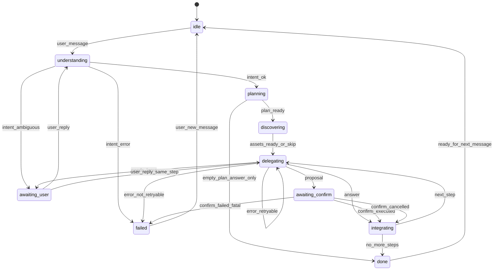

# AI Orchestrator 상태머신

> 사용자 요청 1건을 Orchestrator 가 처리하는 **상태·전이·세션 메타**.  
> 구현은 이 FSM 을 코드로 옮긴다. UI 는 상태별 표시만 담당.

관련: [ai-worker-contract.md](./ai-worker-contract.md) · [ai-catalog-schema.md](./ai-catalog-schema.md) · [ai-platform-layers.md](./ai-platform-layers.md)

---

## 1. 상태

| 상태 | 의미 |
|---|---|
| `idle` | 새 메시지 대기 |
| `understanding` | Intent 분석 중 |
| `planning` | Plan step 배열 생성 |
| `discovering` | 카탈로그 자산 탐색 |
| `delegating` | Worker 호출 중 |
| `awaiting_confirm` | proposal HITL 대기 |
| `awaiting_user` | needs_input 대기 |
| `integrating` | step 결과 통합·다음 step 결정 |
| `done` | 턴 완료 (세션은 유지) |
| `failed` | 복구 불가 실패 (메시지 남김) |

마스터 설계 5단계 대응:

| 마스터 | FSM |
|---|---|
| ① Intent | `understanding` |
| ② Plan | `planning` |
| ③ Asset Discovery | `discovering` |
| ④ Orchestration | `delegating` (+ confirm/user) |
| ⑤ Response | `integrating` → `done` |

---

## 2. 전이



---

## 3. Plan 구조

```ts
type OrchPlan = {
  intent: "collection" | "dataset" | "analytics" | "prediction" | "visualization" | "mixed" | "unknown";
  summary: string;
  steps: OrchStep[];
};

type OrchStep = {
  id: string;
  workerId: WorkerId;
  goal: string;
  status: "pending" | "running" | "awaiting_confirm" | "awaiting_user" | "done" | "skipped" | "failed";
  assets?: CatalogRef[];
  resultSummary?: string;
};
```

규칙:

- **1차 구현(수집·전처리만):** `intent` ∈ { `collection`, `dataset`, `mixed`, `unknown` }.
  - `collection` → `data_readiness`
  - `dataset` → `dataset_engineering` (매핑·가공·파이프라인)
  - `mixed` → 수집 step 후 전처리 step (예: 적재 후 매핑)
  - `prediction` / `visualization` / `analytics` 요청 → `unknown` 또는 고정 안내(“1차 범위 아님, 기존 메뉴 이용”)
- 라우팅은 단순 키워드 우선순위가 아니라 **점수 + 최근 대화 맥락 + 되묻기** 정책을 사용한다.
  - 명확한 수집/전처리 점수 차이가 있으면 해당 워커로 위임
  - 후속 질문은 최근 `workerId` / plan intent 를 우선
  - `unknown` clarification 응답은 다음 턴의 강한 맥락으로 고정하지 않고, 직전의 실제 `collection`/`dataset` 맥락을 계속 찾는다.
  - “3번”, “해줘”, “샘플 보여줘”, “YYYY-MM-DD부터 YYYY-MM-DD까지” 같은 짧은 입력은 최근 맥락을 우선한다.
  - 수집·전처리 키워드가 겹치고 순차 실행 표현이 있으면 `mixed`
  - 겹치지만 애매하면 `needs_input` 으로 “수집 설정인지 전처리인지”를 되묻는다
- `mixed` 에 예측을 넣지 않는다 (2차 이후).
- step 실패 시 기본: 이후 step `skipped`, 사용자에게 보고.

---

## 4. 세션 메타데이터

Orchestrator 세션 (`metadata.app = "ai-orchestrator"`):

```ts
type OrchSessionMeta = {
  app: "ai-orchestrator";
  fsm: {
    state: string;
    plan?: OrchPlan;
    activeStepId?: string;
    pendingToken?: string;
    updatedAt: string;
  };
};
```

메시지 단위:

- user 메시지: 일반
- assistant + `pendingAction`: awaiting_confirm 진입 시 (워커 계약과 동일)
- assistant + `executionResult`: confirm 후
- assistant 최종: integrating → done 시 통합 답변

---

## 4.1 수집 장기 워크플로

턴 단위 `fsm`과 별도로, 여러 대화 턴과 확인 요청을 거치는 수집 작업은
`dp.ai_collection_workflow`에 저장한다.

단계:

`select_api` → `collect_required_input` → `preview_draft` → `register_api` →
`configure_table` → `create_or_bind_table` → `run_ingestion` → `completed`

정책:

- 세션당 `active` workflow는 하나만 허용한다.
- 상태 갱신은 `workflow_id + user_id + revision` 조건으로 수행한다.
- proposal token과 당시 revision을 state에 저장하고 confirm 결과와 함께 다음 단계로 전이한다.
- API 키·토큰은 workflow JSON에 저장하지 않는다.
- 등록 전 샘플은 기존 기관의 인증정보와 비저장 동적 파라미터를 조합해 호출한다.
- 새로고침 시 세션 메시지, pending action, 활성 workflow를 함께 복원한다.

---

## 5. UI 매핑

| FSM | UI |
|---|---|
| `understanding`…`delegating` | 로딩 / “생각 중” |
| `awaiting_confirm` | [확인 실행] [취소] 카드 |
| `awaiting_user` | 질문 목록 + 입력 |
| `done` | 답변, 입력창 활성 |
| `failed` | 오류 + 재시도 안내 |

기존 `/data-agent` 직접 모드는 Orchestrator FSM 을 **쓰지 않는다**. 동일 confirm UX 만 공유.

---

## 6. 구현 단계 (코드 착수 시)

1. [x] **FSM 타입 + 세션 저장** (세션 metadata 에 `fsm` 저장)
2. [x] Intent 분류기: `collection` | `dataset` | `mixed` | `unknown` (예측·시각화는 안내만)
3. [x] Worker 어댑터: `data_readiness` / `dataset_engineering`
4. [x] confirm 전이 (`/api/ai-orchestrator/confirm`)
5. [x] 카탈로그 discovering 읽기 API (`/api/ai-catalog`)
6. [x] 다중 step skeleton (`mixed` = 수집→전처리 plan 생성, 실행은 한 번에 하나의 proposal)
7. [x] 전용 collection workflow 저장소와 revision 기반 Controller
8. [x] 비저장 API draft preview와 provider host allowlist
9. [x] AI Assistant 진행 상태·세션 복원

구현 파일:

- `web/app/api/ai-orchestrator/_lib/intent.ts`
- `web/app/api/ai-orchestrator/chat/route.ts`
- `web/app/api/ai-orchestrator/confirm/route.ts`
- `web/app/api/ai-orchestrator/session/route.ts`
- `web/app/api/ai-orchestrator/_lib/collection-workflow.ts`
- `web/app/api/ai-orchestrator/_lib/workflow-db.ts`

예측·시각화 워커 연결은 본 FSM 문서 개정 후 2차에서 한다.

---

## 7. 실패·취소 정책

| 사건 | 동작 |
|---|---|
| proposal 취소 | step `skipped` 또는 `done`(취소 요약), 다음 step 정책은 plan 플래그로 (기본: 중단) |
| confirm 실패 (retryable) | 같은 proposal 재시도 허용하지 않음(token 소모). 새 proposal 필요 |
| needs_input 무시 후 새 주제 | 새 `understanding` (이전 step failed/skipped) |
| Worker timeout | `error.retryable=true` 이면 1회 재위임, 이후 failed |

---

## 8. 버전

- `fsmVersion: "1.0"`
- 상태 이름 변경은 major. 새 상태 추가는 minor.
